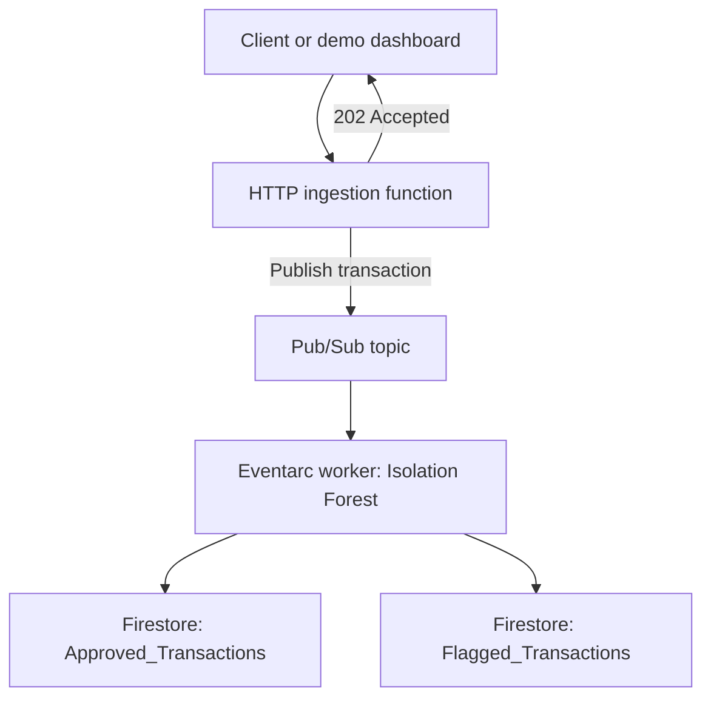

# Fraud Detection on Google Cloud

A serverless transaction anomaly detection demo built with Python, Cloud Functions
(2nd gen), Pub/Sub, Firestore, and scikit-learn. The HTTP function validates and
queues transactions; a separate worker scores them and stores the routing result.

The model uses synthetic data. This project demonstrates an event-driven pipeline;
it has not been evaluated as a fraud detection system on real financial data.
Training and offline tests need no GCP account. Cloud execution requires an active
billing-enabled project; there is no hosted demo maintained by this repository.

## Architecture



HTTP acceptance confirms queue publication when a project is configured. It does
not confirm scoring or storage. The worker reuses a cached model and Firestore
client across invocations. Firestore writes use the transaction ID as the document
ID; missing IDs are derived from the Pub/Sub message ID in the worker.

## Repository layout

| Path | Purpose |
| --- | --- |
| `src/ingest/` | HTTP validation and Pub/Sub publication |
| `src/process_transaction/` | Eventarc entry point, scoring, and Firestore writes |
| `src/train_model/train.py` | Reproducible synthetic training with seed 42 |
| `src/mock_client/` | Traffic generation and deployment smoke checks |
| `src/tests/` | Offline unit and regression tests |
| `dashboard.html` | Browser demo and HTTP traffic controls |
| `deploy.sh` | Deployment using the Google Cloud CLI |
| `.github/workflows/tests.yml` | Training and tests on pushes and pull requests |

## Local setup

Use **Python 3.11** to match the deployment runtime and pinned ML dependencies.
Run these commands from the repository root in PowerShell:

```powershell
py -3.11 -m venv .venv
.\.venv\Scripts\python.exe -m pip install -r requirements-dev.txt
.\.venv\Scripts\python.exe src/train_model/train.py
.\.venv\Scripts\python.exe -m pytest
```

On Linux/macOS, create the environment with `python3.11 -m venv .venv` and use
`.venv/bin/python` for the remaining commands.

The generated `model.pkl` is excluded from Git. Train it locally before deployment;
the deployment script also trains it if absent. Only load model files generated
from trusted code: Python pickle files can execute code when loaded. Training and
serving must use matching scikit-learn versions.

## Run the ingestion endpoint locally

```powershell
$env:GCP_PROJECT_ID = ""
.\.venv\Scripts\functions-framework.exe --source=src/ingest/main.py --target=ingest_transaction --port=8080
```

With an empty project ID, ingestion and database helpers log operations without
contacting Google Cloud. This is a local smoke test, not an end-to-end pipeline.
The HTTP response remains `202` in this mode even though nothing is queued.

Send a sample request from another PowerShell terminal:

```powershell
$payload = @{
    user_id = "demo-user"
    amount = 500
    hour_of_day = 14
    is_new_location = 0
    transaction_velocity = 2
} | ConvertTo-Json
Invoke-RestMethod -Method Post -Uri http://localhost:8080 -ContentType application/json -Body $payload
```

## Transaction API

| Field | Requirement |
| --- | --- |
| `user_id` | Required nonempty string |
| `amount` | Required finite, nonnegative JSON number |
| `transaction_id` | Optional valid Firestore document ID; generated at ingestion if omitted |
| `hour_of_day` | Optional integer 0-23; defaults to the current UTC hour at ingestion |
| `is_new_location` | Optional integer 0 or 1; scorer defaults to 0 |
| `transaction_velocity` | Optional nonnegative integer; scorer defaults to 1 |
| `location`, `merchant_category` | Optional metadata; not model features |

The model features, in order, are `amount`, `hour_of_day`, `is_new_location`, and
`transaction_velocity`. Risk is calculated as `clip(0.5 - decision_function, 0, 1)`;
scores at or above `0.55` are flagged. The score is a heuristic, not a probability.
If the model is missing, the scorer uses fallback rules. If scoring raises an
exception, the worker flags the transaction with `score_error` and a score of `-1`.

Responses: `202` accepted, `400` invalid input, `405` unsupported method, `503`
publisher initialization failure, or `500` queue publication failure. `OPTIONS`
returns `204` for browser preflight requests.

## Deploy

See [deployment instructions](docs/DEPLOYMENT.md) for prerequisites, IAM, and
commands. The script defaults to authenticated ingestion. Existing browser and
mock clients assume an unauthenticated demonstration endpoint; use the explicit
demo setting in the deployment instructions for those clients.

## Dashboard and load testing

Serve the root directory locally with `python -m http.server 8000`, open
`http://localhost:8000/dashboard.html`, and enter your ingestion URL. Do not expose
this development server publicly: the root also contains ignored local files.

The dashboard measures HTTP acceptance. Scores, approved/flagged counts, and
processing animations are **browser estimates**; it does not read Firestore or
display actual worker results. Check Firestore and Cloud Logging to verify those.

```powershell
$env:API_URL = "http://localhost:8080"
$env:N = "50"
.\.venv\Scripts\python.exe src/mock_client/load_tester.py
.\.venv\Scripts\python.exe src/mock_client/verify_deployment.py
```

The load tester defaults to 500 requests using 10 threads and sends one preliminary
request before the batch. It measures ingestion throughput, not worker completion
or detection accuracy. The verification script checks HTTP behavior and prints
instructions for manually checking Firestore; it does not query the database.

## Limitations and next steps

- Evaluate on labeled real-world data before making accuracy or business claims.
- Add request authentication, restricted CORS, quotas, and budget alerts for public use.
- Add dead-letter handling and monitoring; the script enables retries but creates no dead-letter topic.
- Pub/Sub delivery can repeat. Upserts avoid extra documents within a collection, but
  timestamps can change and this does not guarantee exactly-once processing across collections.
- Set a data retention policy before collecting any real transaction information.
- Review dependency updates and run a vulnerability scan before production use.

## Publishing

See [GitHub publishing commands](docs/PUBLISHING.md). Local configuration,
credentials, reports, duplicate dashboards, environments, caches, and model
artifacts are excluded. No license has been selected; add the license appropriate
to your ownership and intended reuse before advertising the project as open source.
